<h1 align="center">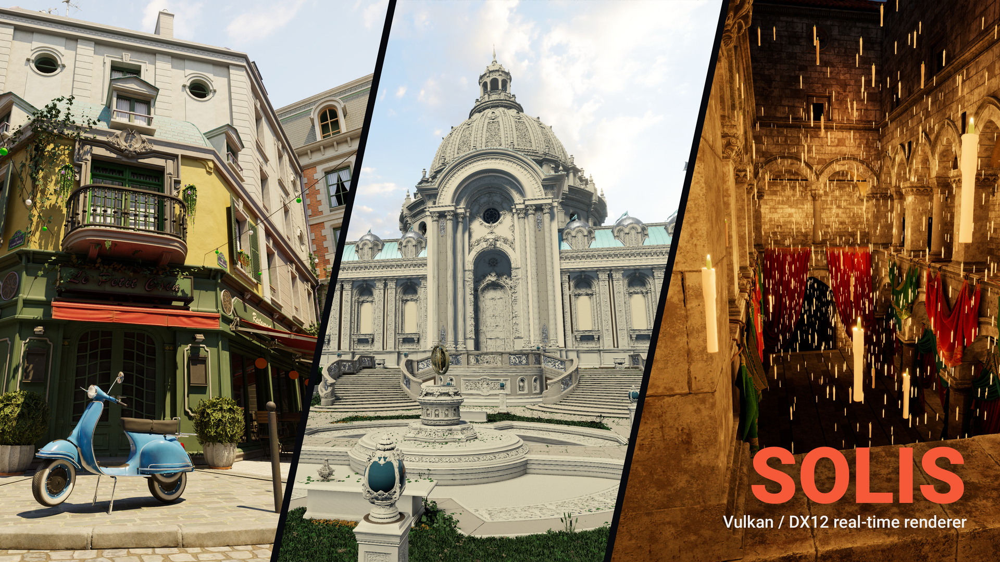</h1>

> A Vulkan / DirectX 12 engine with GPU-driven, Nanite-style geometry and hardware ray-traced global illumination.

`C++` · `Vulkan` · `DirectX 12` · `HLSL` · `Mesh shaders` · `Ray tracing`

An experimental Vulkan / DirectX 12 renderer exploring cutting-edge rendering tech. Geometry is GPU-driven through a Nanite-style meshlet pipeline - continuous LOD, mesh shader rasterization (with a compute fallback), two-pass HiZ occlusion culling, on-demand streaming for scenes larger than VRAM. Real-time global illumination via hardware ray-traced DDGI, plus a reference path tracer for ground truth.

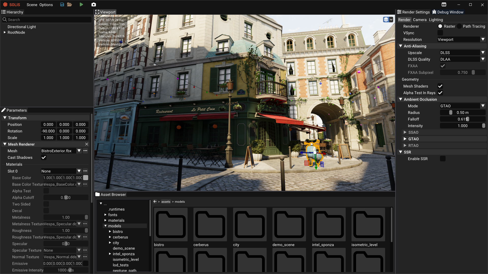

## Many lights: RTXDI + NRD

Direct lighting from thousands of shadow-casting lights through ReSTIR DI (NVIDIA RTXDI), denoised with NVIDIA NRD RELAX.

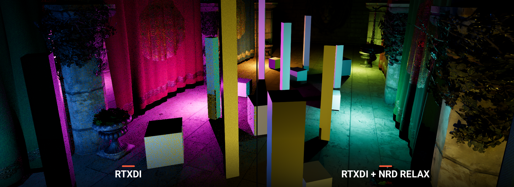

## Meshlet geometry

Geometry goes through a meshlet pipeline. Meshes are split into clusters of ~64 vertices / ~124 triangles using [meshoptimizer](https://github.com/zeux/meshoptimizer) at import time and baked into a binary `.mesh` file along with their LOD hierarchy.

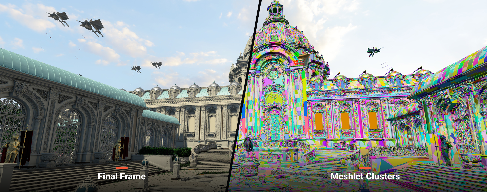
*Each color is one meshlet - a cluster of ~124 triangles the GPU culls and draws on its own.*

### Continuous LOD

Each mesh is preprocessed into a DAG of meshlet groups by iterative simplification. At runtime each group picks its own LOD based on screen-space error.

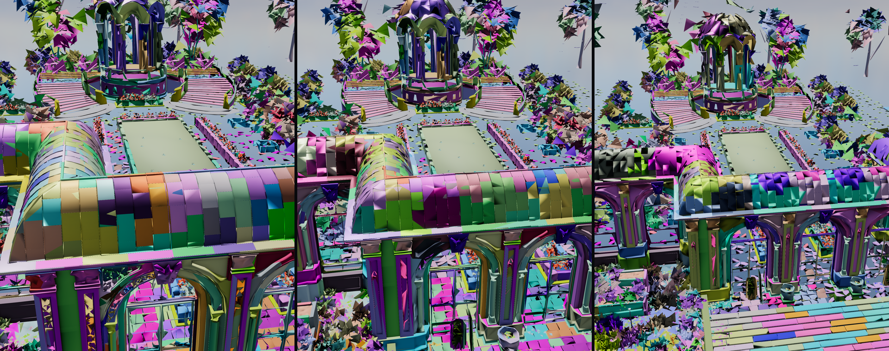

### GPU-driven culling

Culling happens on the GPU. Instances are expanded into per-meshlet work items, each meshlet gets frustum + backface + occlusion tested, and survivors are appended into an indirect buffer. There is no heavy per-object work on the CPU - the whole scene renders as a handful of indirect dispatches.

### Two-pass HiZ occlusion

The previous frame's HiZ is a great occluder for most of the scene but misses anything that just became visible this frame. Two passes solve it:

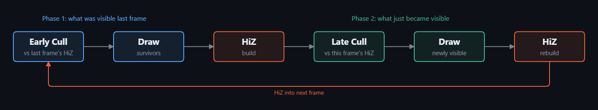

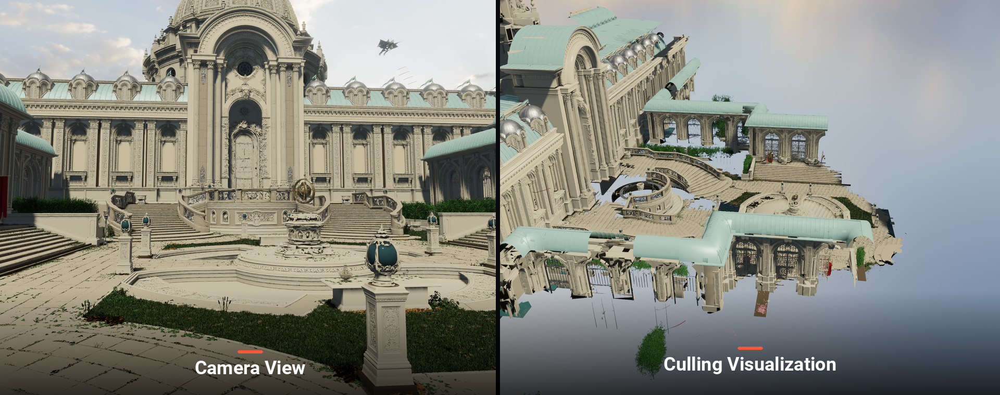

### Geometry streaming

Meshlet data streams in on demand: the GPU asks for what it needs while traversing the LOD hierarchy, the CPU uploads it, and groups that haven't been used in a while get evicted. A coarse root group per mesh stays pinned as a fallback, so the scene always renders even when finer detail hasn't streamed in yet. This is how the engine handles scenes far larger than VRAM. One copy of NVIDIA's Zorah scene is ~10 GB as glTF and ~70 GB once baked into meshlets and LODs - the engine packs 36 copies into a single world and renders it using up to 1 GB of VRAM, streaming the rest in and out as the camera moves.

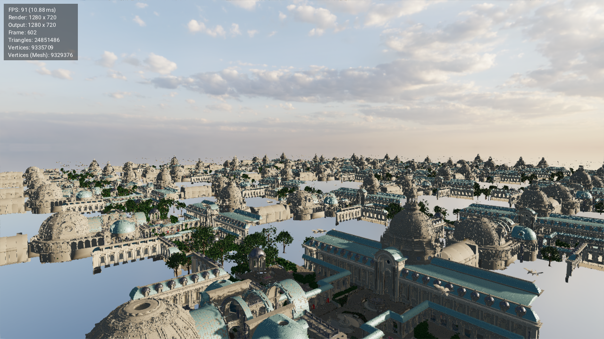

## DDGI

Real-time global illumination via a grid of light probes. Each frame a budget of probes shoots rays against the scene with hardware ray tracing, samples direct lighting at the hits, and writes the result into per-probe irradiance and depth atlases.

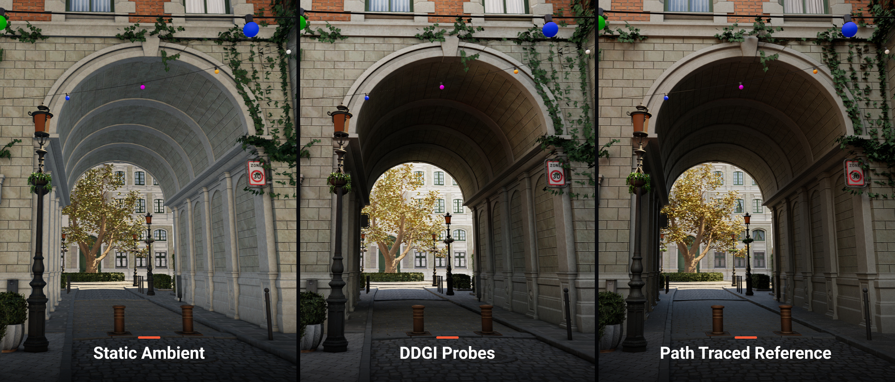

### Cascades

Probes aren't a single grid - they're arranged in nested cascades around the camera. The innermost cascade is dense for fine GI near the viewer, outer cascades are progressively sparser and bigger, so the same probe budget reaches the whole scene without wasting density where it doesn't matter.

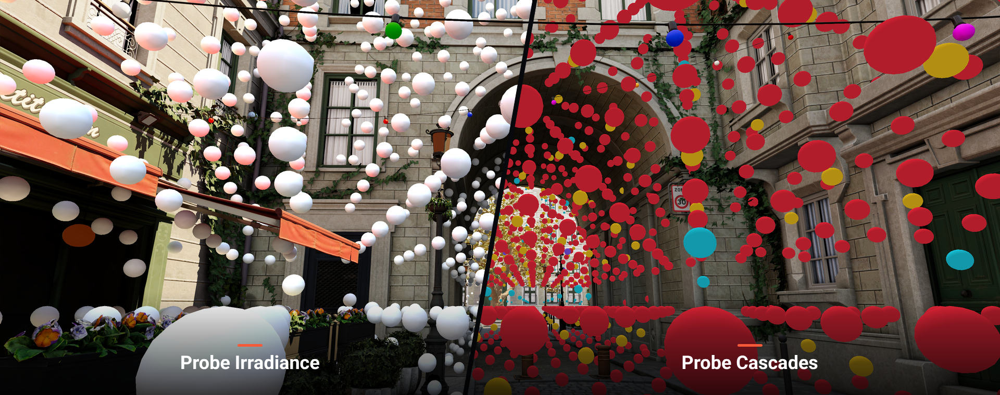

Additional probes passes:

- **Relocation** - probes that land inside walls get nudged into open space so they sample something useful.
- **Classification** - probes trapped in solid geometry or floating in empty space are flagged inactive and skipped, saving a big share of the ray budget.

Per-frame cost is bounded by `probes_per_frame` × `rays_per_probe`, so the GI stays at a fixed budget regardless of volume size.

## FrameGraph

Every frame is described as a graph of passes and resources. The engine schedules it, allocates transient resources, and inserts every layout transition and barrier automatically - renderers just declare what they read and write. A whole frame, visualized with GraphViz:

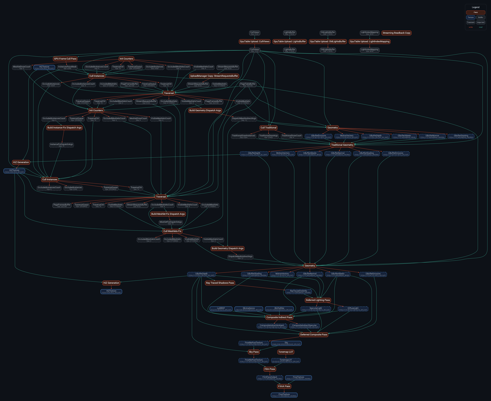

## Other features

- **Lighting** - deferred PBR with directional and point lights, IBL (prefiltered specular + diffuse irradiance + BRDF LUT)
- **Shadows** - directional lights (cascaded shadow maps), point lights (cube shadow maps), with optional ray-traced shadows
- **Ambient occlusion** - SSAO, GTAO, RTAO with custom temporal and spatial denoisers
- **Post-processing** - bloom, tonemapping (ACES, AgX, PBR Neutral, GT), 3D LUT color grading
- **Path tracer** - reference path tracer, used as ground truth
- **Mitsuba bridge** - export the scene to Mitsuba 3 and compare the frame against an external ground truth render
- **RHI** - single abstraction over Vulkan and DX12 with bindless resources
- **Upscaling** - NVIDIA DLSS via Streamline
- **Tooling** - Tracy CPU + GPU profiling, console variables, debug visualizations
- **Physics** - PhysX integration

Plus FXAA and a procedural atmospheric sky.

The same scene rendered by the engine (left) and by Mitsuba 3 straight from the editor (right):

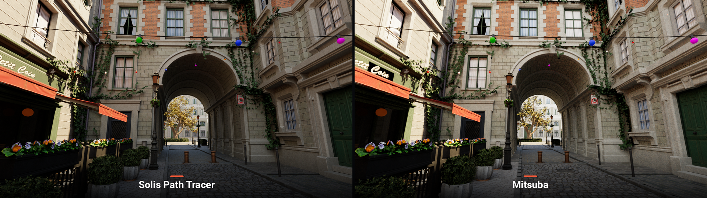

## Building

Windows only for now. Using premake5 and Visual Studio as primary IDE. Needed [Vulkan SDK](https://vulkan.lunarg.com/) and a GPU with mesh shader and ray tracing support.

```
git clone --recurse-submodules https://github.com/Vovan675/Solis
cd Solis
CreateSolution.bat
```

Big models and other heavy content should be downloaded from releases using script.

```
download_assets.bat
```

## Coming next

- **RTX Mega Geometry** - use meshlet cluster data in ray tracing
- **Per-pixel ray-traced GI** - per-pixel ray-traced indirect lighting on top of DDGI
- **Path tracer improvements** - expand material support and use ray reconstruction or other denoiser
- **Upscalers** - FSR and XeSS
- **MaterialX** - basic support of the MaterialX standard
- **macOS support** - Metal 4 backend

## Credits

- [Amazon Lumberyard Bistro](https://developer.nvidia.com/orca/amazon-lumberyard-bistro)
- [Intel Sponza](https://www.intel.com/content/www/us/en/developer/topic-technology/graphics-research/samples.html)
- [nvpro-samples/vk_lod_clusters](https://github.com/nvpro-samples/vk_lod_clusters)
